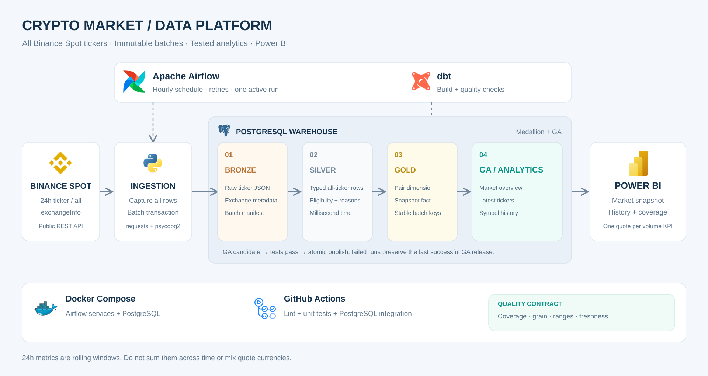
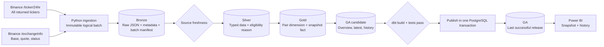
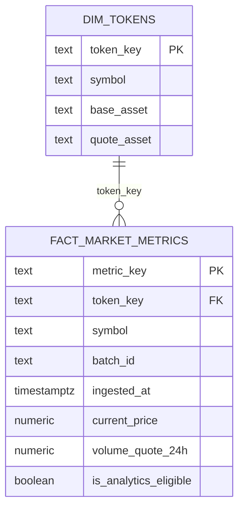
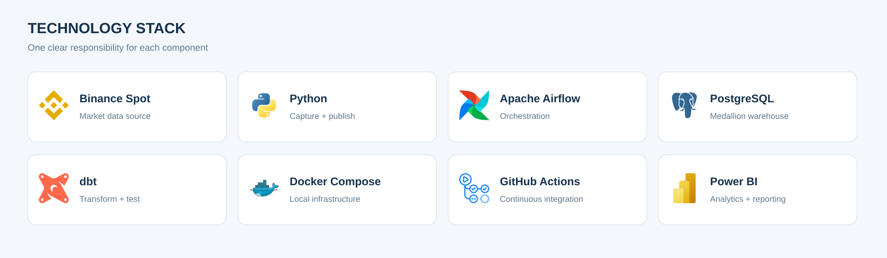
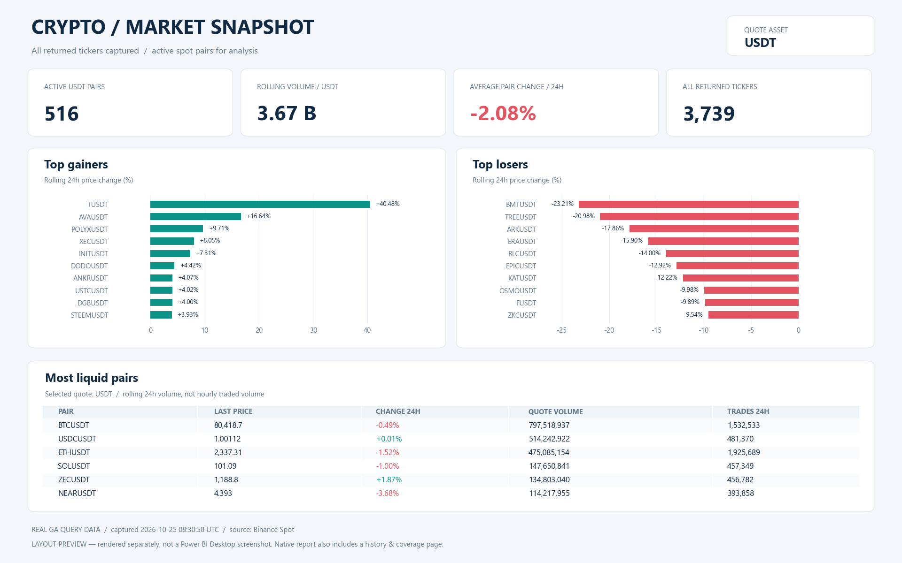

# Crypto Market Data ELT Pipeline

**English summary:** An hourly ELT pipeline captures every ticker returned by Binance Spot's 24-hour endpoint, preserves raw snapshots in PostgreSQL, validates transformations with dbt, and publishes an analytics serving layer for Power BI.

Pipeline thu thập **toàn bộ tickers API Binance Spot trả về**, không dùng watchlist. Dữ liệu đi qua **Bronze → Silver → Gold → GA**, điều phối bằng Airflow. GA là tầng tổng hợp/phục vụ phân tích sau Gold theo thiết kế của dự án; đây là phần mở rộng, không phải tầng bắt buộc của Medallion.

## Kiến trúc hệ thống






Nếu ingestion, freshness hoặc dbt build thất bại, Airflow không chạy bước publish. BI tiếp tục đọc release GA thành công trước đó; card tuổi snapshot giúp nhận ra dữ liệu cũ. **Chưa có SMTP/Slack/on-failure notification**; lỗi được thể hiện qua trạng thái task và logs Airflow.

## Phạm vi dữ liệu và ý nghĩa snapshot

- Gọi `GET /api/v3/ticker/24hr` không truyền `symbol`/`symbols`, không lọc watchlist. Giữ **mọi bản ghi trả về**, kể cả cặp inactive/giá bằng 0.
- `GET /api/v3/exchangeInfo` cung cấp `baseAsset`, `quoteAsset`, status và quyền spot. Không suy luận quote bằng cách cắt hậu tố USDT.
- “All tickers” ở đây là toàn bộ phản hồi endpoint Binance Spot; không bao gồm Binance Futures hoặc mọi tài sản trên mọi sàn.
- Một ticker là **cặp giao dịch**: BTCUSDT và BTCUSDC là hai cặp khác nhau.
- Các số đo 24h là **rolling window**, không phải ngày lịch hay volume của riêng giờ chạy. Không cộng volume giữa các giờ; không dựng OHLC ngày chính xác từ các snapshot này.
- Đây là dữ liệu hiện tại lúc gọi API, không phải dữ liệu lịch sử tại logical date của Airflow. `catchup=False`; không dùng task này để backfill.
- Một lần gọi không bảo đảm mọi cặp có cùng `closeTime`. Dữ liệu raw giữ nguyên timestamp từng cặp.

## Các tầng dữ liệu

| Tầng / Bảng | Grain | Nội dung |
|---|---|---|
| Bronze `raw_crypto_tickers` | symbol + batch_id | Raw ticker JSON, metadata JSON, thời gian batch và ingestion |
| Bronze `ingestion_batches` | batch_id | Manifest chỉ commit khi toàn bộ snapshot đã nạp |
| Silver `stg_crypto_tickers` | symbol + batch_id | Ép kiểu, giữ mili giây, asset metadata, lý do loại khỏi phân tích |
| Gold `dim_tokens` | symbol | Dimension cặp giao dịch; giữ tên cũ để dễ đối chiếu phiên bản trước |
| Gold `fact_market_metrics` | symbol + batch_id | Toàn bộ snapshot đã chuẩn hóa, khóa metric MD5 ổn định |
| GA `latest_tickers` | symbol trong batch được publish | Cặp đủ điều kiện, xếp hạng tăng/giảm và quote volume |
| GA `market_overview` | batch_id + quote_asset | Coverage, breadth và rolling volume theo từng quote |
| GA `symbol_history` | symbol + batch_id | Chuỗi giá/biến động của các snapshot đủ điều kiện |
| GA `publication_status` | một hàng | Batch, captured_at và published_at của release đang phục vụ |

`ga_candidate` là schema kỹ thuật để dbt build/test. Power BI chỉ đọc `ga`.



### Chất lượng và điều kiện phân tích

Silver/Gold giữ tất cả tickers để kiểm tra coverage; không xóa âm thầm các bản ghi bị loại khỏi GA. `exclusion_reason` có thể là `missing_metadata`, `inactive`, `nonpositive_price`, `no_activity`.

GA latest/history chỉ gồm cặp có metadata đầy đủ, status TRADING, cho phép spot, giá > 0, số giao dịch và quote volume > 0. API rỗng, trùng symbol hoặc thiếu ticker của cặp spot đang TRADING làm ingestion fail. Thay đổi listing giữa hai request có thể gây fail tạm thời; Airflow retry thay vì công bố một batch thiếu dữ liệu.

dbt kiểm tra khóa unique/not-null, quan hệ fact-dim, grain Silver/GA, đối chiếu số hàng với manifest, phạm vi số đo và batch GA cần publish. Source freshness cảnh báo sau 75 phút, lỗi sau 120 phút; đo thời gian **nạp nguồn**, không thay thế kiểm tra timestamp từng ticker.

## Điểm nổi bật và design decisions

- **Retry idempotent:** Airflow truyền `run_id` làm `batch_id`. Một batch đã commit là immutable; retry giữ snapshot gốc và không gọi lại API. Raw rows và manifest commit trong cùng transaction. Chạy mới với batch ID khác tạo một snapshot mới.
- **Thời gian tách biệt:** `batch_timestamp` là nhãn lịch chạy, `ingested_at` là thời gian thu thập thực tế, `snapshot_timestamp` là `closeTime` từ API.
- **MD5 surrogate key:** dimension băm symbol, fact băm symbol + batch ID theo định dạng xác định. Đây là khóa kỹ thuật gọn và tái lập; không dùng để bảo mật và không tuyên bố không thể collision. Test unique vẫn bắt buộc.
- **ELT:** Bronze giữ payload để audit/reprocess; SQL/dbt xử lý kiểu dữ liệu, liên kết và kiểm thử.
- **Full table materialization:** dễ kiểm tra, phù hợp demo. Lịch sử tăng khoảng số tickers × số batch. Chưa chuyển incremental; cần retention/partitioning và benchmark trước khi mở rộng.
- **Một DAG run hoạt động:** `max_active_runs=1` tránh các lần rebuild dbt chồng nhau. Không chạy quy trình CLI thủ công đồng thời với DAG.
- **Publish GA:** thay nội dung ba bảng serving trong một transaction. Khi lỗi, rollback giữ release trước. Dùng DELETE thay TRUNCATE để giữ tính nhất quán cho reader theo MVCC. Đây là lựa chọn đơn giản, tốn ghi lại lịch sử; chưa phải cơ chế publish tối ưu cho warehouse lớn.
- **Đơn vị đo:** chỉ tổng hợp quote volume trong cùng quote asset. Không có bước quy đổi BTC/EUR/USDT về USD và không có dữ liệu market cap.

## Tech stack




| Thành phần | Phiên bản / cách dùng |
|---|---|
| Python | 3.10 trong image Airflow |
| Airflow | 2.8.1, LocalExecutor |
| dbt-core / dbt-postgres | 1.12.5 / 1.11.0, virtualenv riêng `/opt/dbt` |
| PostgreSQL | 15 |
| Dependencies ingestion | requests 2.31.0, psycopg2-binary 2.9.9 |
| Serving | Power BI Project (PBIP/PBIR), Import từ GA |

Giữ Airflow theo phiên bản repo ban đầu để giới hạn phạm vi thay đổi. Không xem cấu hình demo này là cấu hình production đã được harden. Các dependency chính được ghim; toàn bộ dependency bắc cầu chưa được khóa bằng lockfile.

## Cấu trúc thư mục

```text
dags/crypto_elt_pipeline.py
scripts/
  ingest_market_data.py       # all tickers + exchange metadata
  init_warehouse.sql         # database mới
  migrate_v2.sql             # giữ nguyên Bronze cũ trong bảng legacy
  publish_ga.py               # transaction publish GA
  smoke_pipeline.py           # integration test với dữ liệu giả lập
  build_powerbi.py             # tái tạo source dashboard
  validate_powerbi.py          # kiểm tra JSON schema Microsoft
dbt_project/
  models/{silver,gold,ga}/
  tests/
powerbi/                       # project, semantic model, report và hướng dẫn
docs/                          # data dictionary, giải thích thay đổi, evidence
tests/
.github/workflows/ci.yml
Dockerfile
docker-compose.yml
.env.example
requirements*.txt
```

## Triển khai local — database mới

Yêu cầu Docker Desktop/Engine đang chạy với Linux containers, Docker Compose v2 và đủ tài nguyên cho Airflow/PostgreSQL.

PowerShell:

```powershell
Copy-Item .env.example .env
# Sửa các giá trị local trong .env trước khi chạy.
docker compose up -d --build
docker compose ps
```

Bash dùng `cp .env.example .env`. Không commit `.env`. Mật khẩu metadata Airflow được chèn vào URL kết nối; dùng giá trị URL-safe theo ghi chú trong example.

- Airflow: [localhost:8080](http://localhost:8080), user/password lấy từ `.env`.
- PostgreSQL cho Power BI: `localhost:5433`, database/user/password lấy từ `.env`.
- Các port chỉ bind vào localhost.
- Trong Airflow, unpause DAG `crypto_medallion_elt_pipeline`, rồi Trigger DAG để chạy ngay.
- Mở Power BI sau khi task `publish_ga` thành công.

### Nâng cấp từ phiên bản watchlist cũ

**Không xóa volume để nâng cấp.** Backup database trước. Nếu volume warehouse đã tồn tại, script init của Postgres không tự chạy lại. Giữ user/password/database cũ trong `.env` vì thay biến môi trường không tự đổi credentials của volume hiện hữu.

Khi DAG cũ đã dừng chạy, chạy migration đầy đủ:

```bash
docker compose up -d postgres-warehouse
docker compose cp scripts/migrate_v2.sql postgres-warehouse:/tmp/migrate_v2.sql
docker compose cp scripts/init_warehouse.sql postgres-warehouse:/tmp/init_warehouse.sql
docker compose exec -T postgres-warehouse sh -c 'psql -v ON_ERROR_STOP=1 -U "$POSTGRES_USER" -d "$POSTGRES_DB" -f /tmp/migrate_v2.sql'
docker compose up -d --build
```

Migration giữ raw cũ trong `bronze.raw_crypto_tickers_legacy`, tạo bảng all-ticker mới. Không gán giả metadata/batch cho lịch sử watchlist cũ; lịch sử GA mới bắt đầu từ lần thu thập mới đầu tiên. Xem [giải thích thay đổi](docs/CHANGES_EXPLAINED.md).

## Kiểm thử và vận hành

Chạy cả pipeline bằng Airflow là cách được khuyến nghị. Khi cần chạy CLI, pause DAG trước và dùng cùng batch ID cho mọi bước:

```bash
docker compose exec airflow-scheduler python /opt/airflow/scripts/ingest_market_data.py --batch-id manual_demo_001
docker compose exec airflow-scheduler bash -c 'cd /opt/airflow/dbt_project && /opt/dbt/bin/dbt source freshness --profiles-dir .'
docker compose exec airflow-scheduler bash -c 'cd /opt/airflow/dbt_project && /opt/dbt/bin/dbt build --profiles-dir . --vars "{batch_id: manual_demo_001}"'
docker compose exec airflow-scheduler python /opt/airflow/scripts/publish_ga.py --batch-id manual_demo_001
```

Chỉ publish khi freshness/build vừa chạy thành công. Muốn lấy snapshot mới, dùng batch ID mới. Xem logs:

```bash
docker compose logs --tail 100 airflow-scheduler
```

Query xác nhận:

```sql
SELECT * FROM ga.publication_status;
SELECT quote_asset, returned_pairs, active_pairs, excluded_pairs
FROM ga.market_overview
WHERE batch_id = (SELECT batch_id FROM ga.publication_status)
ORDER BY active_pairs DESC;

SELECT symbol, current_price, price_change_percent_24h, volume_quote_24h
FROM ga.latest_tickers
WHERE quote_asset = 'USDT'
ORDER BY volume_rank
LIMIT 10;
```

Unit tests: `python -m unittest discover -s tests -v`. CI chạy lint Python và integration test với PostgreSQL 15, dữ liệu giả lập tách khỏi dữ liệu thị trường thật. Script smoke chỉ chạy trên database disposable đã init.

## Dashboard Power BI

Xem [xác nhận Docker/Airflow và kết nối MCP local](docs/RUNTIME_AND_MCP.md) để tiếp tục kiểm tra runtime trên Windows.


Mở [powerbi/CryptoMarket.pbip](powerbi/CryptoMarket.pbip); giữ nguyên các thư mục report và semantic model đi kèm. Xem [hướng dẫn kết nối/refresh](powerbi/README.md).

- **Market snapshot:** quote filter, KPI, top gainers/losers, bảng thanh khoản.
- **History & coverage:** biểu đồ giá từng cặp, rolling quote volume theo snapshot, bảng coverage.
- Không cần API key Binance; chỉ kết nối PostgreSQL GA bằng credentials local.
- Import refresh không tự chạy theo Airflow. Nếu publish lên Power BI Service, cần cấu hình gateway/lịch refresh phù hợp.



Project đã được kiểm tra JSON theo schema Microsoft; **chưa render hoặc xác nhận DAX/Power Query trong Power BI Desktop**. Ảnh trên là preview được dựng riêng từ dữ liệu GA thật. Không có ảnh DAG xanh giả hoặc lịch sử giá giả lập. Chi tiết lần chạy và giới hạn kiểm chứng nằm trong [VALIDATION.md](docs/VALIDATION.md).

## Tài liệu và nguồn

- [Data dictionary](docs/DATA_DICTIONARY.md)
- [Các sửa đổi và lý do](docs/CHANGES_EXPLAINED.md)
- [Kết quả kiểm chứng](docs/VALIDATION.md)
- [Binance REST API](https://github.com/binance/binance-spot-api-docs/blob/master/rest-api.md)
- [Power BI PBIR](https://learn.microsoft.com/en-us/power-bi/developer/projects/projects-report)
- [Power Query PostgreSQL](https://learn.microsoft.com/en-us/power-query/connectors/postgresql)

## Tác giả

Ngô Quốc Dũng · [GitHub](https://github.com/dungngoo1) · [LinkedIn](https://linkedin.com/in/quocdungngo/)
